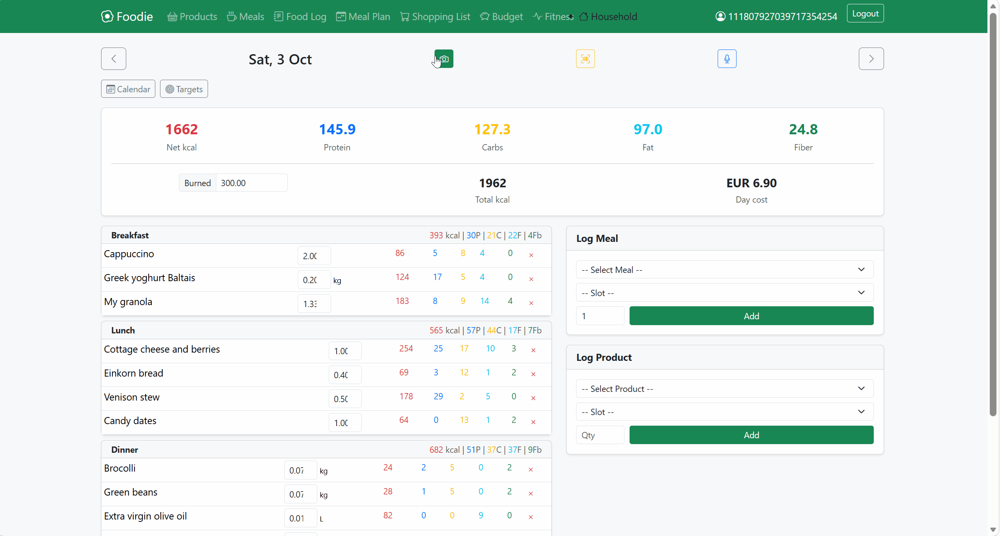
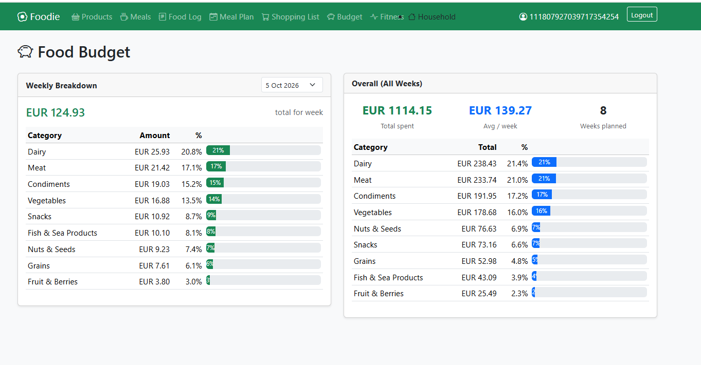

# 🍽️ FoodieApp

A comprehensive meal planning and nutrition tracking application with **AI-powered features** for effortless food logging. Built with Java 25 and Spring Boot 3.5.

[](https://openjdk.org/)
[](https://spring.io/projects/spring-boot)
[](https://github.com/ElgaVigrieze/foodieApp/actions/workflows/ci.yml)
[](LICENSE)

---

## ✨ Key Features

### 🤖 AI-Powered Capabilities

| Feature | Description | Technology |
|---------|-------------|------------|
| **Photo Nutrition Analysis** | Snap a photo of your meal → get instant calorie and macro estimates | Cloudflare Workers AI (Llama 3.2 Vision) |
| **Smart Recipe Import** | Paste any recipe URL (blogs, YouTube, Instagram) → auto-extract ingredients, instructions, and nutrition | Cloudflare Workers AI (Llama 3.3 70B) |
| **Recipe Screenshot Parsing** | Upload a screenshot of a recipe → extract structured data via vision AI | Cloudflare Workers AI (Llama 3.2 Vision) |
| **Voice Food Logging** | Speak what you ate → fuzzy matching finds meals/products in your database | Custom NLP parsing with word-overlap scoring |
| **Barcode Scanner** | Scan product barcodes → auto-fetch nutrition from Open Food Facts API | Open Food Facts Integration |

### 📱 Core Functionality

- **Meal Management** — Create, categorize, and track meals with detailed nutritional information
- **Product Database** — Maintain a personal product library with nutrition data (auto-filled from Open Food Facts)
- **Food Logging** — Track daily intake by meal slot (breakfast, lunch, dinner, snack)
- **Meal Planning** — Plan weekly meals with automatic shopping list generation
- **Shopping Lists** — Auto-generated from meal plans, with manual additions
- **Household Support** — Every user belongs to a household with shared data; roles are owner and member
- **Budget Tracking** — Track food spending alongside nutrition
- **Fitness Integration** — Log workouts and track training plans
- **Brain Tracking** — Automatic reaction-time and processing-speed scores with a monthly scoreboard

---

## 🏗️ Architecture

```
┌─────────────────────────────────────────────────────────────────┐
│                        Frontend (Thymeleaf)                      │
├─────────────────────────────────────────────────────────────────┤
│                     REST API Controllers                         │
│  ┌──────────┐ ┌──────────┐ ┌──────────┐ ┌──────────┐           │
│  │ Meal     │ │ PhotoLog │ │ VoiceLog │ │ Barcode  │  ...      │
│  └──────────┘ └──────────┘ └──────────┘ └──────────┘           │
├─────────────────────────────────────────────────────────────────┤
│                       Service Layer                              │
│  ┌────────────────────┐  ┌────────────────────┐                 │
│  │ PhotoNutrition     │  │ RecipeScraper      │                 │
│  │ Service            │  │ Service            │                 │
│  │ (AI Vision)        │  │ (AI Text + Vision) │                 │
│  └─────────┬──────────┘  └─────────┬──────────┘                 │
│            │                       │                             │
│            ▼                       ▼                             │
│  ┌─────────────────────────────────────────────┐                │
│  │         Cloudflare Workers AI API            │                │
│  │   • Llama 3.2 11B Vision Instruct           │                │
│  │   • Llama 3.3 70B Instruct                  │                │
│  └─────────────────────────────────────────────┘                │
│                                                                  │
│  ┌────────────────────┐  ┌────────────────────┐                 │
│  │ NutritionLookup    │  │ RecipeIngredient   │                 │
│  │ Service            │  │ MatcherService     │                 │
│  │ (Open Food Facts)  │  │ (Fuzzy Matching)   │                 │
│  └────────────────────┘  └────────────────────┘                 │
├─────────────────────────────────────────────────────────────────┤
│                    Data Layer (JPA/Hibernate)                    │
│  ┌──────┐ ┌──────┐ ┌──────┐ ┌──────┐ ┌──────┐ ┌──────┐        │
│  │Meal  │ │Product│ │FoodLog│ │MealPlan│ │User │ │Household│    │
│  └──────┘ └──────┘ └──────┘ └──────┘ └──────┘ └──────┘        │
├─────────────────────────────────────────────────────────────────┤
│                   PostgreSQL / H2 Database                       │
└─────────────────────────────────────────────────────────────────┘
```

---

## 🛠️ Tech Stack

| Category | Technologies                                               |
|----------|------------------------------------------------------------|
| **Backend** | Java 25, Spring Boot 3.5, Spring Data JPA, Spring Security |
| **AI/ML** | Cloudflare Workers AI (Llama 3.2 Vision, Llama 3.3 70B)    |
| **External APIs** | Open Food Facts (nutrition data, barcode lookup)           |
| **Frontend** | Thymeleaf, Bootstrap                                       |
| **Database** | PostgreSQL (production), H2 (development)                  |
| **Authentication** | OAuth2 (Google)                                    |
| **Deployment** | Docker, Fly.io                                             |
| **Build** | Maven                                                      |

---

## 🚀 Getting Started

### Prerequisites

- Java 25+
- Maven 3.8+
- Docker (for a local PostgreSQL), or nothing extra to use the built-in H2 file database
- Google OAuth2 client (required to log in)
- Cloudflare account (optional, only for the AI features)

### Configuration

Copy `.env.example` to `.env` and fill it in, or set the same names as environment variables.
With no database variables the app uses a local H2 file in `./data` and Hibernate manages the schema.

| Variable | Required | Purpose |
|----------|----------|---------|
| `GOOGLE_CLIENT_ID`, `GOOGLE_CLIENT_SECRET` | yes | Google OAuth2 login (the app will not start without them) |
| `PORT` | no | HTTP port, default `9090` |
| `DATABASE_URL`, `DATABASE_DRIVER`, `DATABASE_USER`, `DATABASE_PASSWORD`, `JPA_DIALECT` | for PostgreSQL | Database connection (default: H2 file) |
| `FLYWAY_ENABLED=true`, `DDL_AUTO=validate` | **required with PostgreSQL** | Flyway owns the schema; the app refuses to start on PostgreSQL without them |
| `CLOUDFLARE_ACCOUNT_ID`, `CLOUDFLARE_API_TOKEN` | no | Enables photo and recipe AI features |
| `ADMIN_EMAIL` | no | Admin for usage monitoring |

### Run with a local PostgreSQL

```bash
docker run -d --name foodie-pg \
  -e POSTGRES_USER=foodie -e POSTGRES_PASSWORD=foodie -e POSTGRES_DB=foodie \
  -p 127.0.0.1:5433:5432 -v foodie-pg-data:/var/lib/postgresql postgres:18
```

Port 5433 avoids a clash with a PostgreSQL already installed on 5432. Put this in `.env`:

```
DATABASE_URL=jdbc:postgresql://localhost:5433/foodie
DATABASE_DRIVER=org.postgresql.Driver
DATABASE_USER=foodie
DATABASE_PASSWORD=foodie
JPA_DIALECT=org.hibernate.dialect.PostgreSQLDialect
FLYWAY_ENABLED=true
DDL_AUTO=validate
```

Flyway creates the schema on first start (`src/main/resources/db/migration`). The migrations are PostgreSQL SQL, so on H2 Hibernate creates the schema instead.

### Run Locally

```bash
# Clone the repository
git clone https://github.com/ElgaVigrieze/foodieApp.git
cd foodieApp

# Run with Maven
mvn spring-boot:run

# Or build and run the JAR
mvn package
java -jar target/foodie-0.0.1-SNAPSHOT.jar
```

Visit `http://localhost:9090` (override the port with the `PORT` environment variable).

`GOOGLE_CLIENT_ID` and `GOOGLE_CLIENT_SECRET` must be set before starting - see `.env.example` for all supported variables.

### Run with Docker

```bash
# The Dockerfile copies the pre-built JAR, so build it first
mvn package -DskipTests
docker build -t foodie .
docker run -p 9090:9090 \
  -e GOOGLE_CLIENT_ID=your_client_id \
  -e GOOGLE_CLIENT_SECRET=your_client_secret \
  -e CLOUDFLARE_ACCOUNT_ID=your_id \
  -e CLOUDFLARE_API_TOKEN=your_token \
  foodie
```

### Brain Test Recorder

The **Brain** tab records Human Benchmark scores automatically with a small Tampermonkey userscript:

1. Open **Brain** in Foodie and install the recorder from the *Automatic recorder* card. Refresh the page afterwards.
2. A small **🍽️ Foodie: connected** badge appears on the Brain page once the script is running in that browser. The script reads the token from the page and pairs itself automatically.
3. Use the **Open test** buttons, finish the test, and the result is posted automatically. The badge on the test page shows *saving* and then *saved*.
4. If the badge says **not paired**, reopen the test from Foodie. If no badge appears at all, the userscript is not installed or enabled for that site.

This works on desktop and on Android with **Firefox for Android** or **Kiwi Browser** (both support Tampermonkey). Chrome for Android does not support extensions, so use the manual-entry form there instead. The ingest endpoint is authenticated with a per-user token, which can be regenerated from the Brain page. The Brain page distinguishes a valid token from a live recorder: **Test token** checks the token only, while *Recorder last seen* is updated when the userscript actually reaches the app. The recorder sends a heartbeat when a test page or the Brain page loads, which makes installation problems visible before the first result.

---

## 🎬 Demo



## 📸 Screenshots



---

## 📖 API Documentation

Once the app is running, access the interactive API documentation (you need to be logged in) at:

- **Swagger UI**: [http://localhost:9090/swagger-ui.html](http://localhost:9090/swagger-ui.html)
- **OpenAPI JSON**: [http://localhost:9090/v3/api-docs](http://localhost:9090/v3/api-docs)

---

## 🔮 AI Features in Detail

### Photo Nutrition Analysis

Upload a photo of your meal and get instant nutritional estimates:

```
User uploads: [photo of pasta with meatballs]

AI Response:
  FOOD: Spaghetti with meatballs and marinara sauce
  CALORIES: 650
  PROTEIN: 28g
  CARBS: 72g
  FAT: 24g
  FIBER: 5g
  WEIGHT: 400g
```

### Smart Recipe Import

Paste any recipe URL and the AI extracts structured data:

```
Input: https://example.com/chicken-stir-fry-recipe

Output:
  Name: Chicken Stir Fry
  Category: MAIN_COURSE
  Servings: 4
  Ingredients:
    - Chicken breast: 500g
    - Broccoli: 200g
    - Soy sauce: 45ml
    - ...
  Instructions: "1. Cut chicken into cubes..."
```

The system then:
1. Matches ingredients to existing products in your database (fuzzy matching)
2. Creates new products for unmatched ingredients (auto-fills nutrition from Open Food Facts)
3. Saves the complete meal with calculated nutrition totals

---

## 📁 Project Structure

```
src/main/java/com/foodie/
├── client/          # External HTTP clients (CloudflareAiClient, OpenFoodFactsClient, SafeHttpFetcher)
├── config/          # Security, OAuth2, OpenAPI, household interceptor, schema-management guard
├── controller/      # Web and REST controllers (Meal, Product, FoodLog, MealPlan, ShoppingList,
│   │                #   Budget, Fitness, Household, Brain, PhotoLog, RecipeImport, VoiceLog, Barcode, ...)
│   ├── dto/         # Request/response records
│   └── form/        # Form-binding objects
├── exception/       # Shared exception types
├── model/           # Enums and value types
│   └── db/          # JPA entities
├── repository/      # Data access layer
├── service/         # Business logic (PhotoNutritionService, RecipeScraperService,
│                    #   NutritionLookupService, RecipeIngredientMatcherService, VoiceLogService, ...)
└── util/            # Text matching, calendar and JSON helpers
src/main/resources/db/migration/   # Flyway migrations (PostgreSQL)
```

---

## 🤝 Contributing

Contributions are welcome! Please feel free to submit a Pull Request.

---

## 📄 License

This project is licensed under the MIT License - see the [LICENSE](LICENSE) file for details.

---

## 👤 Author

**Elga Vigrieze**

- GitHub: [@ElgaVigrieze](https://github.com/ElgaVigrieze)