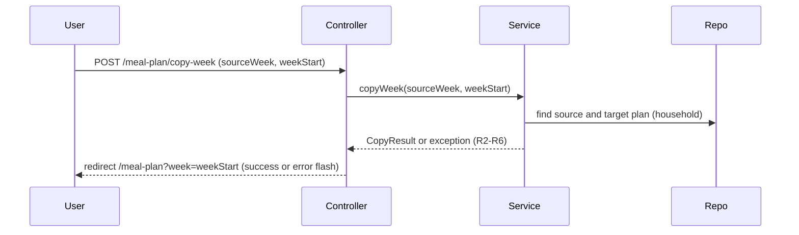

# Copy a meal plan from one week to another

Type: new feature. Status: ready for review. Source request: `docs/requests/copy-plan-brief.md`.
Weeks are named relative to the current week **W**: the Monday on or before the server's current date, computed the same way as the page does (`MealPlanController.java:48`). W-1 is the week before W, W+1 the week after, and so on. Tests build their data relative to W, not on fixed dates.
The examples were checked read-only on the local PostgreSQL (`foodie-pg`, household 1); the plan and entry ids below refer to that demo data.

## 1. Examples (these are also the test scenarios)

Data in use (household 1): plans 10/11/12/13/14 for weeks W-1 (3 entries), W (14, of which 2 use the archived meal "Demo old stew": entry 14 Wed dinner, entry 20 Fri lunch), W+2 (3), W+3 (2, **frozen**), W+1 (0); empty plans for W-6 to W-2; no plan for W-7 and W+4.
Each case is computed against the same data (not cumulative). "After" = entries in the target after the copy. Refusal checks run in the order of rule R11.

| # | Source week → target week | Covers | Expected result |
|---|---|---|---|
| 1 | W → W+1 | R7, R9, R13: current week into the empty next week | OK, copied 12, skipped 0, archived 2, after 12 |
| 2 | W-1 → W | R8: chili Mon dinner (4 vs 24 servings) and pasta Tue dinner already in target; chicken salad new | OK, copied 1, skipped 2, archived 0, before 14, after 15 |
| 3 | W-1 → W+2 | R8: same slot, different meal is not a duplicate | OK, copied 3, skipped 0, archived 0, after 6 |
| 4 | W → W+2 | R8, R13: only oatmeal Wed breakfast matches; the 2 old stew entries are archived | OK, copied 11, skipped 1, archived 2, before 3, after 14 |
| 5 | W-1 → W+3 | R6: frozen target | refused (frozen), still 2 entries |
| 6 | W-2 → W+1 | R5: source plan has no entries | refused (nothing to copy) |
| 7 | W-7 → W+1 | R5: no source plan; no plan row is created for W-7 | refused (nothing to copy) |
| 8 | W → W | R2: same week | refused (same week) |
| 9 | W+2 → W+1 | R3: source after the current week, has entries | refused (source not current or past) |
| 10 | W+1 → W+2 | R3, R11: first week after the current week (boundary); empty, but R3 wins | refused (source not current or past) |
| 11 | Wednesday of W → Wednesday of W+1 | R1: dates snap to Monday; same as case 1 | OK, copied 12, skipped 0, archived 2 |
| 12 | W-1 → W-2 | R4: target before the current week | refused (target in the past) |
| 13 | W → W+4 | R9, R13: target has no plan, so one is created | OK, copied 12, archived 2, plan created |
| 14 | W-2 → W+3 | R11: source empty and target frozen | refused (nothing to copy) |
| 15 | W → W+1, run a second time after case 1 | R8, R13: all active entries already there | OK, copied 0, skipped 12, archived 2, after 12 (no refusal) |

Entry-level results: case 1 and 13 contain the prepared Wed breakfast oatmeal (entry 6) with `prepared = false` in the copy (R7), and do not contain entries 14 and 20 (R13). In cases 2 and 4 the prepared entry is the skipped one. Case 2 detail: entry 16 skip, entry 17 copy, entry 18 skip.

Added regression/validation cases (not in the table above):

| # | Case | Expected |
|---|---|---|
| A | A source entry with `servings = NULL` (not present in real data; use a test fixture) | the copy has servings 1 |
| B | User with no household posts a copy | `ForbiddenException`, nothing written |
| C | Other household has a plan for the same source week | never read or copied (lookup is by the user's household) |
| D | Any successful or refused copy | source plan and its entries unchanged |
| E | Single-entry copy and drag-copy (`/meal-plan/copy`) | behave exactly as today |
| F | Missing or malformed `sourceWeek` or `weekStart` | form validation error, back to the page, nothing written |
| G | Source week (W or earlier) whose only entries use archived meals (test fixture) | refused (nothing to copy), nothing written (R5) |
| H | Source entry with an archived meal whose day, slot and meal are already in the target (test fixture) | not copied, counted as archived, not as skipped (R13 before R8) |

## 2. Need and decisions

People plan every week by hand although their weeks are mostly the same. One action should fill a week from another week, and the user then adjusts the differences. Copy only adds entries (merge); there is no replace mode.

- **D1** Source week must be the current week or earlier ("the plan for next week is prepared in the current week"). Target week must be the current week or later. The current week starts on the Monday on or before today.
- **D2** An entry is skipped when the target already has an entry with the same day, slot and meal; servings are ignored and the existing entry wins.
- **D3** Result goes to the user as a flash message; refusals use the existing error handling and the page must show the `error` flash.
- **D4** A source week with no plan or no entries is refused; no plan row is created for it.
- **D5** Out of scope as listed in section 7.
- **D6** Entries whose meal is archived are not copied (archived meals are already hidden from the add form, `MealService.java:48`). They are counted and reported in the message. A source week whose only entries use archived meals counts as nothing to copy (R5).
- **D7** Copying into a frozen week is refused (R6), even though add, move, copy, servings and prepared ignore frozen today (defect 3). Reason: the bug in the current implementation is known but not fixed yet, no value in introducing the same bug in a new feature. Therefore correcting this behaviour for full week copy already now. Aligning the other operations is a separate issue.
- **Case 12 (confirmed):** a past target week is refused. **Case 14 (confirmed):** nothing-to-copy is reported before frozen target.
- **Prepared (confirmed):** copied entries start with `prepared = false`.

## 3. Business rules

| # | Condition | Result | Examples |
|---|---|---|---|
| R1 | Any date is given for either week | Snap it to the Monday on or before it (same as `getOrCreateForWeek`) | 11 |
| R2 | Source Monday = target Monday | Refuse: "Choose a different week to copy from." | 8 |
| R3 | Source Monday > current Monday | Refuse: "You can only copy from the current week or an earlier week." | 9, 10 |
| R4 | Target Monday < current Monday | Refuse: "You can only copy into the current week or a later week." | 12 |
| R5 | Source plan missing, or has no entries whose meal is active (not archived) | Refuse: "Nothing to copy from that week." Do not create a plan for the source. | 6, 7, 14, G |
| R6 | Target plan exists and is frozen | Refuse: "The target week is frozen. Unfreeze it first." | 5 |
| R7 | Copying an entry | New entry with the same day, slot, meal and servings (NULL becomes 1); `prepared = false`. Not copied: `frozen`, `name`, `MealPlanProduct`. | 1, 13, A |
| R8 | An entry that passed R13 matches an entry that the target held before the copy (same day, slot, meal) | Skip it; count it as skipped. Matching ignores servings and `prepared`. Two identical entries inside the source are both copied unless the target already has the match. Same slot with a different meal is not a match. | 2, 3, 4, 15 |
| R9 | Target plan missing and R2-R6 passed | Create it as `getOrCreateForWeek` does (name "Week of <Monday>", current user as owner, current household), then copy | 1, 13 |
| R10 | Copy succeeds, with any counts (including copied 0) | The source is never changed; the whole copy runs in one transaction (all or nothing) | D |
| R11 | Order of refusals | R2, then R3, then R4, then R5, then R6; the first that applies is reported | 10, 14 |
| R12 | Plans are looked up by the current user's household | A user with no household is refused (existing `requireCurrentHousehold`); other households' plans are never visible | B, C |
| R13 | The meal of a source entry is archived (`Meal.isArchived()`, column `meals.archived`) at the time of the copy | Not copied; counted as archived, not as skipped. Checked before R8. The source entry is left as it is. | 1, 4, 11, 13, 15, G, H |

Precision/empty values: counts are integers; `servings` is an integer copied as is; an empty source, or a source with only archived-meal entries, is R5; "all duplicates" is a success with copied 0 (case 15).
R3 and R4 together mean the source is always earlier than the target.

## 4. Acceptance criteria

1. Given plan 11 (14 entries, 2 of them with the archived meal, week W) and the empty plan 14 (week W+1), when the user copies W into W+1, then plan 14 has 12 entries, none prepared, none with the archived meal, plan 11 is unchanged, and the page shows "Copied 12 entries (2 archived meals not copied)." (case 1).
2. Given case 2's data, when copying W-1 into W, then plan 11 gains only the Wed lunch chicken salad (2 servings), has 15 entries, and the message says "Copied 1 entry (2 skipped as duplicates)." (case 2).
3. Given the frozen week W+3 as target, when copying into it, then the user is returned to the page with "The target week is frozen. Unfreeze it first." and no entry is added (case 5).
4. Given a source week with no entries, no plan, or only archived-meal entries, when copying, then the user sees "Nothing to copy from that week." and no plan row exists for the source (cases 6, 7, G).
5. Given the current week W, when the source is W+1 or the target is W-2, then the user sees the R3 or R4 message (cases 10, 12).
6. Given a successful copy to a week without a plan, when it finishes, then that plan exists with name "Week of " followed by the Monday of W+4 in ISO format (yyyy-MM-dd) (case 13).
7. Given the copy was already done, when repeating it, then nothing is added and the message says "Copied 0 entries (12 skipped as duplicates, 2 archived meals not copied)." (case 15).
8. Given the viewed week is before the current week, then the "Copy from week" control is not shown (the service still refuses).

Message text: "Copied N entries" ("entry" when N = 1), then in parentheses, separated by ", ", only the parts that are > 0, in this order: "M skipped as duplicates", "K archived meals not copied" ("archived meal" when K = 1).

## 5. Data model and migration

No change to tables or columns. New rows only in `meal_plan_entries` (and `meal_plans` when R9 applies). No migration, no existing rows are touched.

## 6. Flow and API

New (all names marked "new"):
- `MealPlanForms.CopyWeek(sourceWeek, weekStart)` (new record in `src/main/java/com/foodie/controller/form/MealPlanForms.java`): `sourceWeek` is the date to copy from, `weekStart` is the viewed (target) week and the redirect target; both `@NotNull @DateTimeFormat(iso = DATE)`, the same convention as the other records (`MealPlanForms.java:36`).
- `POST /meal-plan/copy-week` (new) in `src/main/java/com/foodie/controller/MealPlanController.java`, next to `copyEntry` (`MealPlanController.java:80`). It calls the service, sets the `success` flash and redirects with `backToWeek(form.weekStart())` (`MealPlanController.java:100`).
- `MealPlanService.copyWeek(LocalDate sourceWeek, LocalDate targetWeek)` returning a new `CopyResult(copied, skipped, archived)` in `src/main/java/com/foodie/service/MealPlanService.java`, `@Transactional`. Look up plans with the existing `MealPlanRepository.findByWeekStartAndHouseholdId` (`src/main/java/com/foodie/repository/MealPlanRepository.java:11`) using `currentUserService.requireCurrentHousehold()` (`src/main/java/com/foodie/service/CurrentUserService.java:53`); create the target with the existing `getOrCreateForWeek` (`MealPlanService.java:37`) only after R2-R6 pass; add entries with `MealPlan.addEntry` (`src/main/java/com/foodie/model/db/MealPlan.java:77`).
- Refusals R2-R5 throw `BadRequestException`, R6 throws `ConflictException` (both exist in `src/main/java/com/foodie/exception/`). For a POST the existing handler redirects back to the Referer page with an `error` flash (`src/main/java/com/foodie/controller/WebExceptionHandler.java:172`), so the controller needs no try/catch.
- `src/main/resources/templates/meal-plan/weekly.html`: add a small form next to the week navigation (`weekly.html:14`): a date input defaulting to `prevWeek` (already in the model, `MealPlanController.java:39`), a hidden `weekStart`, and a "Copy" button; hide it when `weekStart < currentWeekStart` (`MealPlanController.java:48`). Add an alert block for the `error` flash beside the `success` one (`weekly.html:9`).

## 7. Out of scope

Templates, recurring plans, replace mode, copying single days or slots, anything about the shopping list or its regeneration (the saved list for the target week is not updated by this change), copying `MealPlanProduct`, and the defects below.

## 8. Open questions and follow-ups

Assumptions (not confirmed by the analyst):
- A1 The date input is a plain date field that snaps to Monday (R1); a week picker is a UI detail.
- A2 The date picker defaults to the week before the viewed week.
- A3 The refusal messages above are suggested wording.
- A4 The copy control is hidden for past weeks (UI only).
- A5 Any household member may copy (same rule as other plan actions).

Open questions: none.

Defects found (log as separate issues, not fixed here):
1. No unique constraint on `meal_plans(week_start, household_id)`; concurrent requests can create duplicate plans (`src/main/resources/db/migration/V1__baseline.sql:163`, only a primary key at `:323`). Duplicates in the 10 most recent weeks: none; older weeks not verified.
2. A GET of `/meal-plan` creates a plan row for every week viewed (`src/main/java/com/foodie/controller/MealPlanController.java:33`).
3. Add, move, copy, servings and prepared ignore `frozen`; only remove checks it (`src/main/java/com/foodie/service/MealPlanService.java:72`).
4. `show` displays the raw `week` parameter while the plan is for its Monday (`MealPlanController.java:32`).
5. `weekly.html` never renders the `error` flash (`src/main/resources/templates/meal-plan/weekly.html:9`); this feature adds it for its own refusals only.
6. `MealPlan.getShoppingList()` ignores servings, unlike `MealPlanService.getShoppingList` (`src/main/java/com/foodie/model/db/MealPlan.java:57`, `MealPlanService.java:130`).
7. `MealPlanProduct` has no repository or service usage in `src` (templates not verified).
